<a href="https://aaris.tech"></a>

<a href="https://github.com/jonarihen/Homelabrrr"></a>
<a href="https://github.com/jonarihen/caddy-forticertsync"></a>
<a href="https://github.com/jonarihen/tools-platform"></a>


<a href="https://aaris.tech"></a>
<a href="https://www.linkedin.com/in/jonathan-aaris-henningsen-33b215196/"></a>
